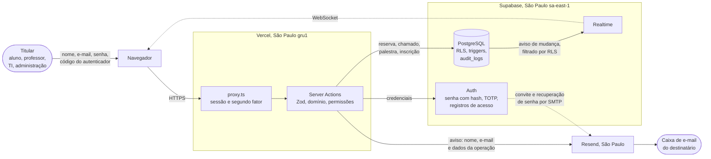

# Fluxo dos dados pessoais

Versão 1.0, de 12/11/2026. Atende ao item 3 da Seção 6 das orientações da
disciplina ("inventário de dados pessoais e diagrama do fluxo dos dados"). O
inventário descreve cada dado; este documento mostra por onde ele passa.

## Visão geral

Três pontos do desenho importam para a LGPD:

- **Tudo fica no Brasil.** As funções da Vercel rodam em `gru1`, o banco e a
  autenticação em `sa-east-1` e o Resend envia pela região de São Paulo. As
  três empresas têm sede nos Estados Unidos, e isso está dito na Política de
  Privacidade (seção "Transferência internacional").
- **O navegador nunca fala com o banco usando a chave secreta.** A chave
  publicável, a única que chega ao navegador, só alcança o que as políticas de
  RLS liberam para a sessão. A chave secreta existe apenas no servidor.
- **O Realtime não é um atalho.** O aviso de mudança passa pelas mesmas
  políticas de leitura: o aluno só é avisado das reservas da própria turma.

## Fluxo por operação

| Operação | Dado pessoal que circula | Caminho | Onde fica | Registro na auditoria |
|---|---|---|---|---|
| Convite | Nome, e-mail, papel, curso e turma (aluno) | Administração, Server Action, Supabase Auth, SMTP do Resend | `auth.users`, `profiles` | `user_invited` |
| Primeiro acesso | Senha nova, segredo do TOTP | Navegador, Supabase Auth | `auth.users`, `auth.mfa_factors` | `password_changed`, `mfa_enrolled` |
| Aceite dos termos | Versão aceita e data | Server Action, `profiles` | `profiles.terms_version`, `terms_accepted_at` | `terms_accepted` |
| Login | E-mail, senha, código TOTP | Server Action, Supabase Auth | Sessão em cookie | `login` ou `login_failed` (com o e-mail digitado) |
| Reserva | Professor responsável, turma, disciplina, quem registrou | Server Action, domínio, `create_booking` | `bookings` | Trigger `bookings_audit` |
| Aviso de reserva | Nome e e-mail do professor, dados da reserva | Server Action, Resend | Caixa do professor | Não se aplica |
| Chamado | Quem abriu, descrição, quem atendeu, nota de solução | Server Action, funções do banco | `tickets` | Trigger `tickets_audit` |
| Palestra nova | Nome e e-mail de cada aluno dos cursos de destino | Server Action, Resend, uma mensagem por aluno | Caixa de cada aluno | Trigger `lectures_audit` |
| Inscrição | Aluno e palestra | Server Action, `inscrever_em_palestra` | `lecture_enrollments` | Trigger `lecture_enrollments_audit` |
| Cancelar a própria conta | Identificador da conta | Server Action, `anonimizar_conta`, Supabase Auth | Perfil anonimizado, e-mail trocado, conta bloqueada | `account_anonymized` |
| Remoção pela administração | Identificador da conta | Server Action, `remover_usuario` | Igual ao anterior | `user_removed` |

## O que não sai do sistema

- Nenhum dado vai para ferramenta de análise, publicidade ou inteligência
  artificial. Não há script de terceiros nas páginas.
- O Resend não recebe senha, papel, segredo de segundo fator nem registro de
  auditoria. O rastreamento de abertura e de clique está desligado.
- A Vercel recebe o que trafega nas requisições, mas não guarda os dados: as
  funções não gravam nada em disco e os logs de execução não registram o corpo
  das requisições.
